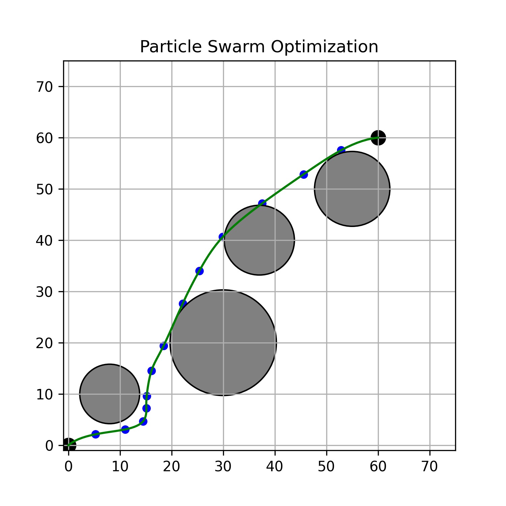
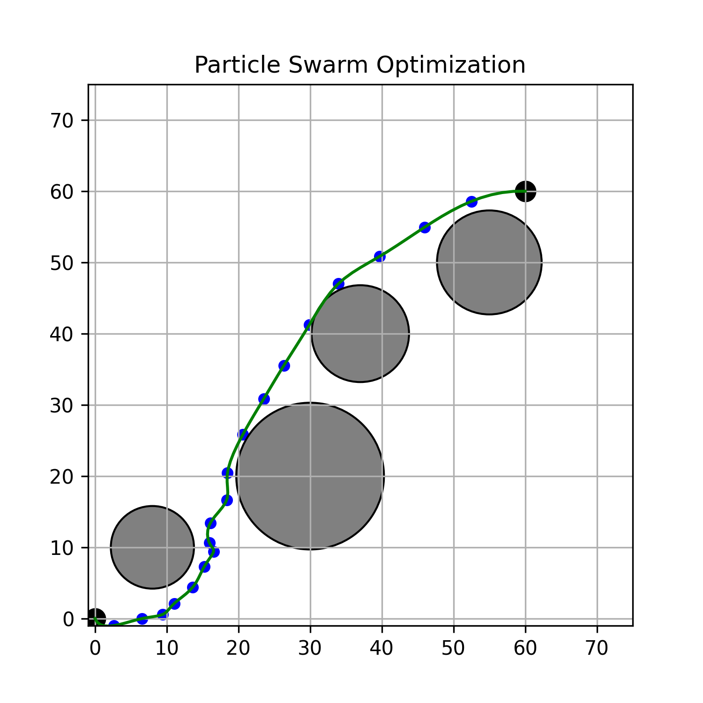

# PSO Shortest Path

Particle Swarm Optimization that finds a short, obstacle-free path between two points on a 2D map with circular obstacles. The path is a chain of waypoints, and every particle in the swarm is one complete candidate path.

<p align="center">
  
  
</p>

Black dots are the start and goal, blue dots are the optimized waypoints, the green line is a cubic spline through them, and the grey circles are obstacles.

## How it works

Each particle holds `DIM` waypoints, so a particle is a `DIM × 2` array of (x, y) coordinates. The swarm starts with random waypoints and random velocities, then on every iteration each waypoint is pulled toward two things: the best path that particle has found so far (weighted by `c1`) and the best path the whole swarm has found (weighted by `c2`). Velocity is clamped to `±max_vel` per axis.

A few details that differ from textbook PSO:

**Obstacle repulsion.** After a waypoint moves, it is checked against every circle. If it landed inside one, it gets pushed out along the line from the circle's center, and the same waypoint is processed again until it is clear. The check uses `r² + 1` rather than `r²`, which gives obstacles a small safety margin.

**Damped inertia near the start.** Inertia is scaled by `min(1, sqrt(i) / 4)`, where `i` is the waypoint index. The first few waypoints carry less momentum, so the beginning of the path settles faster than the end.

**The fitness function.** `loss_function` returns the square root of the *sum of squared* segment lengths, not the sum of segment lengths. Minimizing squared segments rewards evenly spaced waypoints as well as short paths. The path length shown on the plot or printed to the console is the real one, computed separately.

## Scripts

| Script | Map | Waypoints | Swarm × iterations | Output |
|---|---|---|---|---|
| `pso.py` | (1, 1) → (10, 20), 3 obstacles | 13 | 100 × 1000 | Straight-line plot with path length and run time |
| `PSO_CubicSpline.py` | (0, 0) → (18, 18), 4 obstacles | 13 | 150 × 2000 | Spline plot, saved as `results.png` |
| `PSO_CubicSpline1.py` | (0, 0) → (60, 60), 4 obstacles | 19 | 150 × 2250 | Spline plot, path length printed, saved as `dim_22.png` |
| `pso1.py` | (1, 1) → (10, 20), 3 obstacles | 11 | 100 × 1000 | Does not run, see Known issues |

`obstacles.py` defines the `Point` and `Obstacle_Circle` classes shared by the scripts.

`18_18.zip` holds result plots for `DIM` from 6 to 20 on the 18 × 18 map, and the `dim_*.png` files in the root are runs on the 60 × 60 map with 10, 13, 16, 19 and 22 waypoints.

## Running it

You need Python 3 with NumPy, SciPy and Matplotlib.

```bash
git clone https://github.com/f220b/PSO-Shortest-Path-.git
cd PSO-Shortest-Path-
pip install numpy scipy matplotlib
python PSO_CubicSpline.py
```

Progress is printed in 2% steps. The optimizer is plain Python loops over every particle and waypoint, so the larger maps take a while.

## Changing the setup

Start, goal and waypoint count are module-level constants:

```python
DIM = 13
START = ob.Point(0, 0)
END = ob.Point(18, 18)
```

Obstacles and PSO parameters are set in `main()`:

```python
obstacles = [
    ob.Obstacle_Circle(2, ob.Point(9, 14)),   # radius, center
    ob.Obstacle_Circle(4.5, ob.Point(5, 6)),
]

best_location = particle_swarm_optimization(
    max_iterations=2000,
    swarm_size=150,
    max_vel=3,
    step_size=1,
    inertia=0.9,
    c1=2.05,
    c2=2.05,
    circles=obstacles,
)
```

More waypoints let the path bend more tightly around obstacles, but they also add dimensions to search, and past a point the result gets worse rather than better. Compare `dim_13.png` with `dim_22.png`: the 22-waypoint run has small zigzags and a final segment that cuts through an obstacle.

If you move the goal far from the origin, adjust the plot limits in `plot_graph` (`plt.xlim` / `plt.ylim`). Initial waypoints are always drawn from the 0–20 square (`np.random.rand(...) * 20`), so on large maps the swarm starts bunched in one corner and has to spread out.

## Known issues

- **Only waypoints are checked against obstacles, not the segments between them.** Two valid waypoints on opposite sides of a circle can produce a line, or a spline, that passes through it. `dim_22.png` shows this happening.
- **`pso1.py` crashes** with `TypeError: list indices must be integers or slices, not tuple`. It passes a Python list to `loss_function`, which expects a NumPy array, and it never writes the updated positions back to `particles_loc`. It also defines its own `Obstacle_Circle` whose exit direction points *toward* the center. Treat it as an abandoned draft.
- `PSO_CubicSpline1.py` always saves to `dim_22.png` regardless of `DIM`, so change the filename before each run if you want to keep previous results.
- `PSO_CubicSpline.py` saves to `results.png` and will overwrite it on every run.
